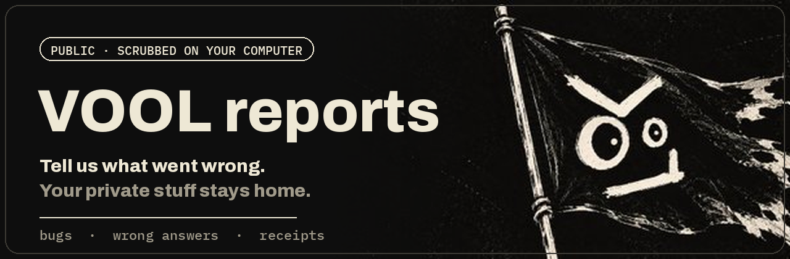
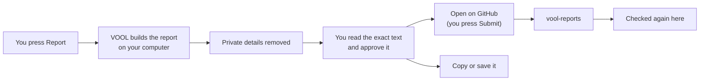

<p align="center">
  
</p>

<p align="center">
  <a href="https://github.com/Parad0x-Labs/vool-reports/issues/new?template=wrong_answer.yml"></a>
  <a href="https://github.com/Parad0x-Labs/vool-reports/issues/new?template=bug_report.yml"></a>
</p>

<p align="center">
  <a href="https://github.com/Parad0x-Labs/vool-reports/actions/workflows/scrub.yml"></a>
  <a href="https://github.com/Parad0x-Labs/vool-reports/actions/workflows/tests.yml"></a>
  <a href="LICENSE"></a>
</p>

**This is where [VOOL](https://github.com/Parad0x-Labs/vool) bugs and wrong answers come to get fixed.**
Every report is built on your own computer, scrubbed of private details, and shown to you word for word
before you decide to send it. Nothing leaves without your click.

## Send a report in three clicks

| | What you do | What happens |
| --- | --- | --- |
| **1** | Press **Report** or 👎 under an answer, or highlight the wrong part and press **Report**. Something broke? Use **Report a problem** in the menu. | VOOL builds the report on your computer and removes private details. |
| **2** | Read the preview and press **Approve**. | You see the exact text that would be sent. Untick anything you don't want in it. |
| **3** | Press **Open on GitHub**, then **Submit** on the page that opens. | Your report lands here, already filled in. VOOL itself sends nothing. |

No GitHub account? Press **Copy report** or **Save a local copy** instead, and share it however you like.



## What a report contains

- **What went wrong**, in your words.
- **For a wrong answer:** the part you highlighted, or the whole answer. Your question is left out unless you tick the box.
- **The VOOL version and build**, so we know exactly which code you ran.
- **Your computer's shape:** OS version, chip, memory, GPU, local model server version.
- **A short health check:** is the local model server answering, is the model installed, free disk space as a range.
- **The answer's receipt:** model, provider, tokens, time, which steps ran and error codes. Never the content of those steps.
- **A fingerprint** that groups the same problem from different people, so we can see how many hit it.

<details>
<summary><b>See an example report</b></summary>

```text
# [wrong-answer] Wrong or made up

## Environment
- VOOL version: 0.7.1
- source: git 1a2b3c4d5e6f
- OS: Darwin | arch: arm64 | Python 3.12.13
- OS version: macOS 15.1
- chip: Apple M2 | CPU cores: 8 | RAM (GB): 16
- GPU: Apple M2 (mps) | GPU memory (GB): shared
- Ollama: 0.12.3 | install: macOS app

## Health
- local model server answering: yes
- local text models installed: 3
- model in this report installed: yes
- free disk: 20-100 GB

## Wrong answer
- reason: Wrong or made up
- quoted: the part of the answer the user selected

> The capital of Australia is Sydney.

## What was wrong
It's Canberra.

## Answer receipt
- record: verified
- model: qwen3:8b | provider: ollama
- tokens: 412 | time: 3100 ms | web sources: 0
- actions: none recorded

---
bug-report-fingerprint: 59842839426e2884ff178db15ab4f723
```

</details>

## What never leaves your computer

VOOL removes these before you even see the preview:

> 🔑 keys, passwords and tokens · 🔢 PINs and one-time codes · 💳 card numbers · 🏦 bank numbers (IBAN) ·
> 📞 phone numbers · ✉️ email addresses · 👛 wallet addresses · 👤 your user name and computer name ·
> 📁 folder paths with your name in them · 🪪 the personal details saved in your VOOL profile

VOOL can't recognise every name or private fact you typed in ordinary sentences, so please read the
preview before you approve it. You can untick any section you'd rather keep.

## A second check, here

Every new or edited report is checked again by [`scripts/scrub.py`](scripts/scrub.py). If it finds a key,
password, PIN, card number or similar, it masks it right away and labels the report `needs-scrub`, so a
maintainer clears the earlier version from the edit history. It also labels reports by kind and points
out repeats of an earlier report.

You can edit or close your own report at any time.

## Security problems

Please **don't** post them here. Use
[private vulnerability reporting](https://github.com/Parad0x-Labs/vool/security/advisories/new) instead.

## Labels

| Label | Meaning |
| --- | --- |
| `wrong-answer` | VOOL answered something wrong, outdated, unsafe, or not what was asked |
| `bug` | Something in the app broke |
| `from-app` | Sent through VOOL's report button (it carries a report fingerprint) |
| `needs-scrub` | The check here masked something private; a maintainer clears the history |
| `needs-info` | We need more from the reporter; closes after 21 quiet days |
| `duplicate` | Same fingerprint as an earlier report |
| `confirmed` | Reproduced by a maintainer |
| `fixed` | Fixed in a release |

<details>
<summary><b>For maintainers</b></summary>

- Search for a `bug-report-fingerprint:` line to find every report of the same problem.
- `.github/workflows/scrub.yml` re-checks opened and edited reports, masks what it finds, labels them and flags repeats.
- `.github/workflows/labels.yml` creates the labels (it runs on its own when the file changes, or from the Actions tab).
- `.github/workflows/stale.yml` closes `needs-info` reports after 21 quiet days.
- After a `needs-scrub` report, open the issue's **edited** menu and delete the earlier revision.
- Run the checks locally with `python3 -m unittest discover -s tests`.

</details>
